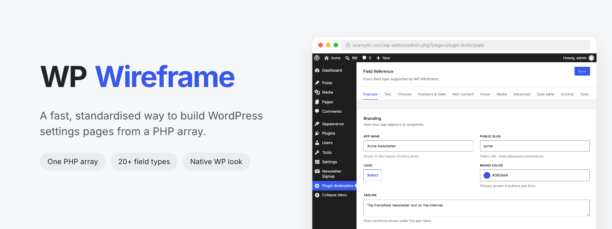
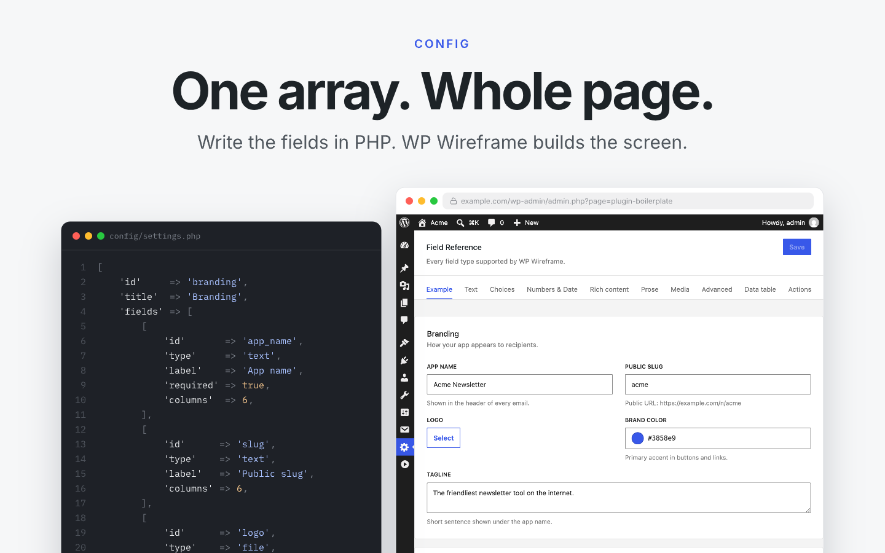
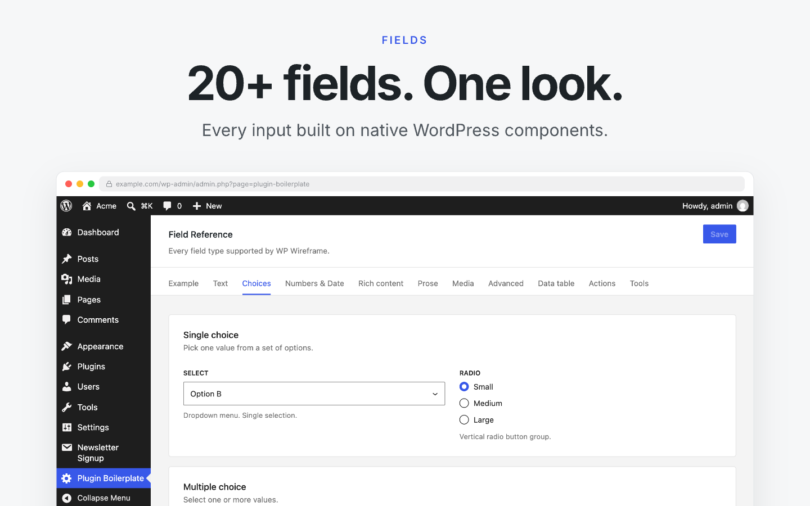
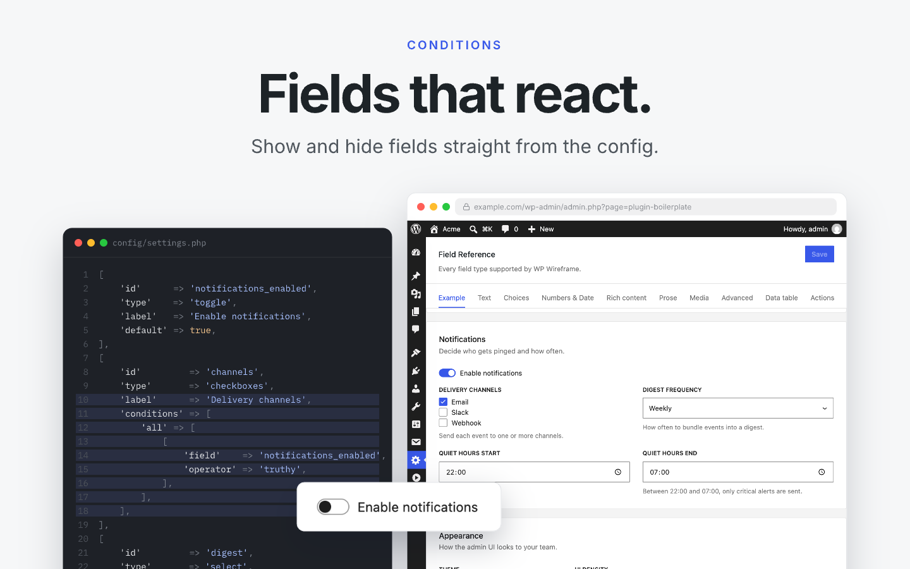
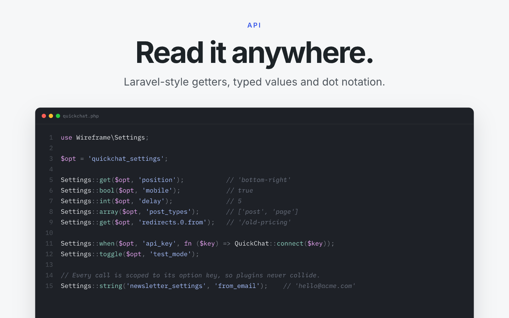
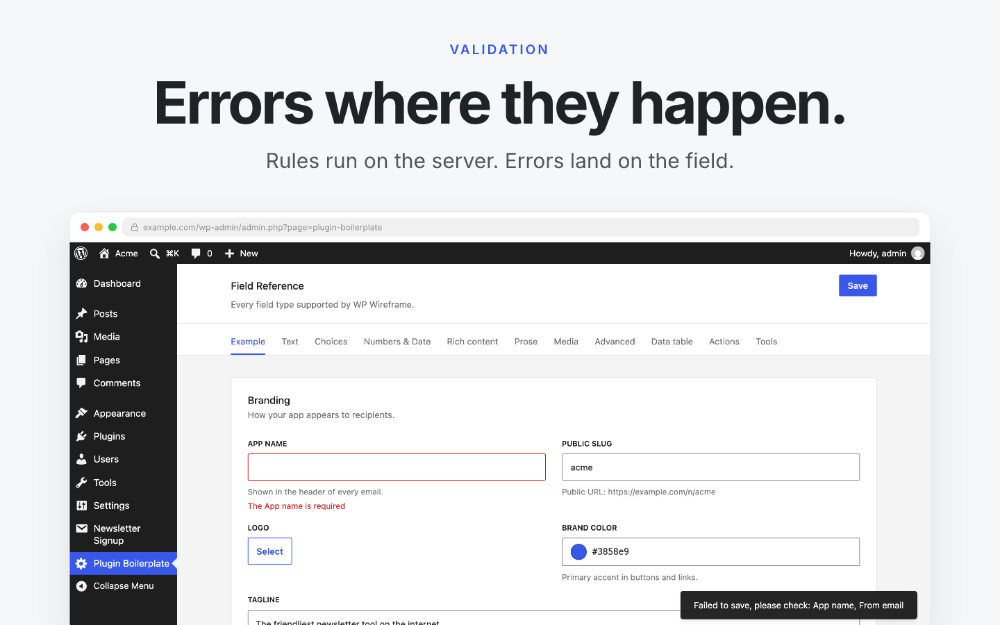

<picture>
  <source media="(prefers-color-scheme: dark)" srcset=".github/banner-dark.png">
  
</picture>

# WP Wireframe

**[Install](#install)** · **[Quick Start](#quick-start)** · **[Documentation](https://tdrayson.github.io/wp-wireframe/docs/)** · **[Contributing](https://tdrayson.github.io/wp-wireframe/docs/contributing/)**

**Skip the admin UI. Ship your plugin.** A fast, standardised way to build WordPress settings pages. List your fields in a PHP array and WP Wireframe builds the whole admin page using WordPress React components. Same clean UI, same field behaviour, same patterns across every plugin you ship.

- **One PHP array, full settings page** — tabs, sections, and 20+ field types
- **Standardised fields** — every input looks and behaves the same across plugins and projects
- **Native WordPress look** — built on `@wordpress/components` and `@wordpress/admin-ui`
- **Laravel-style API** — `Settings::get()`, `Settings::bool()`, dot notation
- **Validation & conditional fields** — server-side rules and show/hide logic built right into the field config
- **Role-based access** — per-field view/edit gating using role slugs or capabilities
- **Multi-page, repeaters, import/export, action buttons, i18n** — included out of the box
- **Zero JS build** — pre-built React app ships with the package



<div align="center">
  
  
  
  
</div>

## Requirements

- PHP 8.1+
- WordPress 6.5+

## Install

WP Wireframe is a library, not a standalone plugin. Bundle a copy inside your own plugin's `vendor/` folder.

### Composer (recommended)

Add the GitHub repo to your plugin's `composer.json` — no Packagist needed:

```bash
composer config repositories.tdrayson/wp-wireframe git https://github.com/tdrayson/wp-wireframe
```

\- or -

```json
{
    "repositories": [
        {
            "type": "vcs",
            "url": "https://github.com/tdrayson/wp-wireframe"
        }
    ]
}
```

\- then -

Install:

```bash
composer require tdrayson/wp-wireframe
```

And require Composer's autoloader from your plugin's main file:

```php
require_once __DIR__ . '/vendor/autoload.php';
```

### Manual download

Download the [latest release zip](https://github.com/tdrayson/wp-wireframe/releases/latest), extract to `your-plugin/vendor/wp-wireframe/`, and require:

```php
require_once __DIR__ . '/vendor/wp-wireframe/vendor/autoload.php';
```

See [Installation](https://tdrayson.github.io/wp-wireframe/docs/getting-started/installation/) for the full walkthrough.

## Quick Start

Three files. About fifteen lines of bootstrap.

### 1. Your plugin file

```php
<?php
/**
 * Plugin Name: My Plugin
 * Description: A plugin with settings powered by WP Wireframe.
 */

require_once __DIR__ . '/vendor/autoload.php';

add_action('init', function () {
    Wireframe\App::boot([
        'prefix'     => 'my-plugin',
        'page_title' => __('My Plugin', 'my-plugin'),
        'option_key' => 'my_plugin_settings',
        'config'     => __DIR__ . '/config/settings.php',
    ]);
});
```

### 2. `config/settings.php`

```php
<?php

return [
    'tabs' => [
        [
            'id'       => 'general',
            'title'    => __('General', 'my-plugin'),
            'sections' => [
                [
                    'id'     => 'main',
                    'title'  => __('Main Settings', 'my-plugin'),
                    'fields' => [
                        ['id' => 'site_name', 'type' => 'text', 'label' => __('Site Name', 'my-plugin')],
                        ['id' => 'contact_email', 'type' => 'email', 'label' => __('Contact Email', 'my-plugin')],
                        ['id' => 'notifications', 'type' => 'toggle', 'label' => __('Enable Notifications', 'my-plugin'), 'default' => true],
                    ],
                ],
            ],
        ],
    ],
];
```

### 3. Read settings anywhere

```php
use Wireframe\Settings;

$opt = 'my_plugin_settings';   // matches your boot's option_key

$name = Settings::get($opt, 'site_name', 'Default');
$send = Settings::bool($opt, 'notifications');
```

Activate the plugin and the settings page appears in the admin menu.

## Documentation

Everything else lives at **[tdrayson.github.io/wp-wireframe/docs](https://tdrayson.github.io/wp-wireframe/docs/)**:

- [Field types](https://tdrayson.github.io/wp-wireframe/docs/field-types/text-family/) — every field type, its `args`, and examples
- [Settings API](https://tdrayson.github.io/wp-wireframe/docs/reference/settings-api/) — reading, writing, and checking values
- [Hooks & filters](https://tdrayson.github.io/wp-wireframe/docs/reference/hooks-and-filters/) — every hook the framework fires or applies
- [Configuration](https://tdrayson.github.io/wp-wireframe/docs/configuration/boot-options/) — boot options, config structure, multi-page and submenu pages
- [Features](https://tdrayson.github.io/wp-wireframe/docs/features/conditional-visibility/) — conditional visibility, role-based access, validation, save/reset, action field
- [Contributing](https://tdrayson.github.io/wp-wireframe/docs/contributing/) — working on the package and docs, Playground previews
